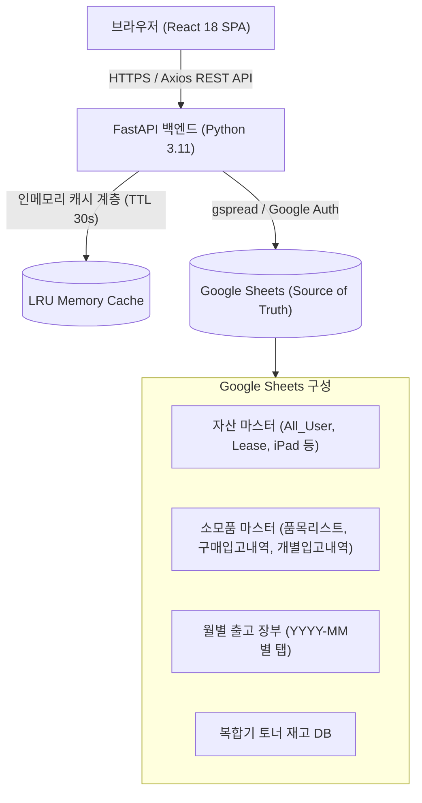
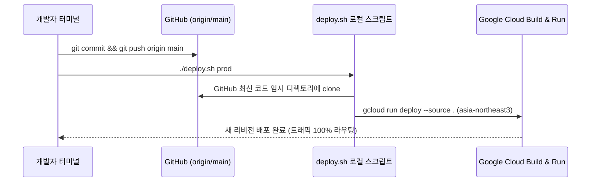

# 📘 ASSET_INFO 시스템 기술 명세서 및 개발 인수인계 가이드
> **문서 버전**: v2.5 (최종 업데이트: 2026-10-21)  
> **시스템 명칭**: 사내 IT 자산 & 소모품 통합 관리 웹 애플리케이션 (ASSET_INFO)  
> **운영 환경**: Google Cloud Run (asia-northeast3, 서울 리전)  
> **운영 URL**: `https://asset-info-1015498761413.asia-northeast3.run.app`  
> **진실의 원천(Source of Truth)**: Google Sheets (Google Drive API / gspread)

---

## 1. 시스템 개요 및 목적

### 1.1 시스템 개요
본 시스템은 사내 IT 팀의 일상 업무인 **하드웨어 자산(노트북, iPad, 모니터, 프린터 등)**과 **소모품(사무용품, 마우스, 케이블, 토너 등)**의 입고·출고·재고 추적을 웹 브라우저에서 실시간으로 일원화 관리하기 위해 개발된 풀스택 웹 애플리케이션입니다.

### 1.2 핵심 설계 철학
1. **Google Sheets as Database**: 전통적인 RDBMS(PostgreSQL, MySQL 등) 대신 사내 비개발자 및 운영진이 스프레드시트 형태로 직접 열람·백업할 수 있도록 **Google Sheets를 데이터 저장소(Source of Truth)**로 사용합니다.
2. **반응형 SPA + 경량 고성능 API**: 프론트엔드는 React 18 + Vite 기반의 고속 SPA로 구현하고, 백엔드는 Python 3.11 + FastAPI 비동기 서버로 구성하여 실시간 시트 I/O 병목을 메모리 캐싱(`_get_cached`, TTL 30초)으로 극복합니다.
3. **독립적 실재고 관리 & 마감 스냅샷**: 월별 출고 현황을 어떤 월로 조회하든 **소모품 마스터 리스트의 재고는 조회 월에 영향을 받지 않고 누적 실재고를 유지**하며, 월말 마감 시점에 당시의 재고를 스냅샷 형태로 안전하게 박제합니다.



---

## 2. 기술 스택 (Tech Stack)

| 레이어 | 기술 | 상세 버전 / 라이브러리 | 선정 이유 |
| :--- | :--- | :--- | :--- |
| **프론트엔드** | React | React 18, Vite 7 | 고속 HMR, 컴포넌트 기반 UI, 가상 DOM |
| **상태/서버 쿼리** | React Query | @tanstack/react-query v5 | 서버 데이터 캐싱, 자동 리패치, 낙관적 업데이트 |
| **HTTP 통신** | Axios | axios 1.7+ | 인터셉터 및 RESTful 요청 처리 |
| **스타일링** | Pure CSS / Inline | Custom Modern CSS (CSS Grid, Flexbox) | 외부 CSS 라이브러리 의존성 없는 가벼운 번들 |
| **백엔드** | Python / FastAPI | Python 3.11, FastAPI, Uvicorn | 고성능 비동기 API, Pydantic 기반 입력 검증 |
| **데이터 레이어** | Google Sheets API | gspread, google-auth | 실시간 시트 읽기/쓰기, 배치 업데이트 |
| **컨테이너/배포**| Docker / Cloud Run | Docker, Google Cloud Run (Serverless) | 자동 확장, 무중단 배포, 서울 리전 저지연 서빙 |

---

## 3. Google Sheets 구조 및 데이터베이스 모델

본 시스템은 **4개의 독립된 Google Spreadsheet**를 유기적으로 연결하여 운영합니다 (`config.py` 참조).

```
config.py
├── SPREADSHEET_ID                        ← 사내 전체 IT 자산 (노트북, iPad 등)
├── CONSUMABLES_MASTER_SPREADSHEET_ID     ← 소모품 마스터, 재고 요약, 구매입고, 개별입고
├── CONSUMABLES_OUTBOUND_SPREADSHEET_ID   ← 월별 소모품 출고 장부 (월별 탭 자동 생성)
└── TONER_SPREADSHEET_ID                  ← 복합기 토너 실재고 전용 DB
```

### 3.1 소모품 마스터 시트 (`CONSUMABLES_MASTER_SPREADSHEET_ID`)
1. **`품목리스트` (Item Master)**
   * **컬럼 구조**: `A: 대분류` | `B: 품목명` | `C: 단가` | `D: 관리여부(O/X)` | `E: 구매수량(base_qty)` | `F: 추가수량(order_qty)` | `G: 구매사이트(URL)`
   * **재고 계산 공식**: `총재고(total_stock) = base_qty + order_qty`
   * **현재고(current_stock)**: `total_stock - 누적출고량(dispatched_qty) - 현재대여량(rented_qty)`
2. **`구매입고내역` (Purchase Records)**
   * **컬럼 구조**: `A: 날짜` | `B: 품목명` | `C: 수량` | `D: 구매단가` | `E: 구매처` | `F: 구매사이트` | `G: 담당자` | `H: 비고`
3. **`개별입고내역` (Individual Inbound)**
   * **컬럼 구조**: `A: 날짜` | `B: 품목명` | `C: 수량` | `D: 비고` | `E: 출처`
4. **`재고현황_스냅샷` (Inventory Snapshots)**
   * 월별 마감 시점의 품목별 기초재고, 당월출고, 기말재고를 박제하여 저장.

### 3.2 월별 출고 장부 (`CONSUMABLES_OUTBOUND_SPREADSHEET_ID`)
* **탭 네이밍 룰**: `YYYY-MM` (예: `2026-04`, `2026-08`, `2026-10`)
* **컬럼 구조**: `A: 날짜` | `B: 품목명` | `C: 출고수량` | `D: 수령자/지급대상` | `E: 출고구분(일반/위탁)` | `F: 담당자` | `G: 지급방법/배송` | `H: 비고`
* **월별 마감 헤더**: 행 1에 마감 상태 표기 (`CONFIRMED:YYYY-MM-DD` 또는 일반 헤더)

### 3.3 복합기 토너 재고 DB (`TONER_SPREADSHEET_ID`)
* **탭 이름**: `복합기_토너_재고_DB`
* **컬럼 구조**: `A: 번호` | `B: 프린터 모델` | `C: 토너 품번` | `D: 색상` | `E: 실재고(Current Stock)` | `F: 적정재고` | `G: 비고`
* **특징**: 일반 소모품과 달리 단일 셀에 실시간 잔여 수량을 기록하는 **정적 재고 방식**을 취함.

---

## 4. 핵심 비즈니스 로직 및 계산 알고리즘

### 4.1 소모품 재고 계산 로직 (v2.9 기준 공식 확립)
> [!IMPORTANT]
> **기초재고(E열)는 재고 부족 여부를 판정하는 '기준 수량'이며, 재고 수량 계산에 포함되지 않습니다.**
> **추가수량(F열)이 실제 총 재고 수량이며, 입고 발생 시 F열에 자동 가산됩니다.**

* **계산 공식**:
  $$\text{총 재고(Total Stock)} = \text{재고 수량(F열, order\_qty)}$$
  $$\text{현재 실재고(Current Stock)} = \text{총 재고(F열)} - \text{누적 출고량} - \text{대여중 수량}$$
  $$\text{부족 경고(Low Stock)} = \text{현재 실재고} \le \text{기준(적정) 수량(E열, base\_qty)}$$

* **조회 월 완전 독립 원칙**:
  * 사용자가 출고 탭에서 4월, 7월 등 과거 월을 조회할 때 마스터 리스트의 재고가 과거 시점으로 왜곡되는 현상을 원천 방지함.
  * 프론트엔드 `ItemsTab`은 백엔드 호출 시 항상 `dispatch_mode=cumulative`로만 고정 호출.
  * 관리자가 마스터 상세수정 모달에서 F열(재고 수량)을 수기 입력/수정하여 실사를 맞출 수 있음.
  * 입고/구매 등록 시 `order_qty(F열)`에 수량이 더해져 총 재고로 관리됨.

### 4.2 토너 실재고 동기화 & 정규화 매칭 (`_match_toner_name`)
* 토너는 품목명 표기가 출고지마다 다를 수 있음 (예: `CLT-K504S`, `CLT-K504S(검정)`, `sclt-k504s`).
* **정규화 매칭 알고리즘**:
  1. 공백 제거 및 소문자화 (`lower().replace(" ", "")`)
  2. 괄호 안 색상 한글 표기(`(검정)`, `(파랑)`) 제거
  3. 삼성/HP 접두사(`sclt-` vs `clt-`) 정규화 매칭
* **재고 증감**:
  * 출고 발생 시: `consume_toner_stock(item_name, qty)` → 해당 품번 행의 E열 수량 즉시 차감
  * 출고 취소/삭제 시: `restore_toner_stock(item_name, qty)` → 해당 품번 행의 E열 수량 즉시 가산

### 4.3 월별 재고 마감 스냅샷 역산 보정 알고리즘
* **문제점**: 마감 시점 당시의 실재고는 이미 당월 출고량이 차감된 상태이므로, 단순 저장 시 기초재고가 이중 차감되는 오류 발생.
* **해결 알고리즘**:
  $$\text{마감 시점 기초재고} = \text{현재 실재고} + \text{당월 출고량}$$
  $$\text{마감 시점 기말재고} = \text{현재 실재고}$$
* 이를 통해 마감 스냅샷 시트에 `[품목명, 기초재고, 당월출고량, 기말재고, 마감일시]`가 오차 없이 영구 박제됨.

### 4.4 통합 상세 수정 모달 (`ItemDetailModal`) 아키텍처
기존에 4개로 흩어져 있던 기능을 단일 모달로 통합:
1. **기본 정보 & 사진 관리**:
   * 제품 사진: Canvas API 기반 크롭/리사이즈/회전 모달(`ImageCropModal`) 연동 → 용량 최적화 Base64로 저장
   * 대분류, 품목명, 단가, 구매 사이트 URL, 재고추적여부(`is_tracked`)
2. **입고 및 가격 이력 통합**:
   * "가격 이력"과 "개별 추가"를 **"통합 입고 및 구매 관리"**로 단일화
   * 새 입고 등록 시:
     * `[v] 실재고(추가 수량) 즉시 반영`: `order_qty(F열)` 또는 토너 DB 실재고 자동 가산
     * `[v] 마스터 기준 단가 / 사이트 자동 갱신`: 단가 및 공식 구매 URL 즉시 동기화
   * 과거 내역 조회: `구매입고내역` 시트 + `개별입고내역` 시트 데이터를 날짜 역순으로 병합 반환.

---

## 5. 핵심 API 명세서 요약

### 5.1 소모품 API (`backend/routers/consumables.py`)

| Method | Endpoint | 설명 | 주요 파라미터 / Payload |
| :--- | :--- | :--- | :--- |
| `GET` | `/api/consumables/items` | 품목 마스터 리스트 조회 | `dispatch_mode=cumulative` |
| `POST`| `/api/consumables/items` | 품목 추가 및 기본 정보 수정 | `category, item_name, price, purchase_url, is_tracked, base_qty, order_qty` |
| `DELETE`| `/api/consumables/items` | 품목 마스터 삭제 | `row_index, item_name` |
| `GET` | `/api/consumables/items/{item_name}/purchase-history` | 특정 품목의 통합 입고/구매/단가 히스토리 및 통계 조회 | `item_name` (Path) |
| `POST`| `/api/consumables/purchase-history` | 새 입고/구매 기록 추가 (실재고 자동 가산 지원) | `date, item_name, quantity, unit_price, vendor, purchase_url, staff, note, update_stock, update_master` |
| `DELETE`| `/api/consumables/purchase-history/{row_index}` | 입고/구매 기록 삭제 (실재고 복원 차감 지원) | `row_index, item_name, quantity, restore_stock, source_type` |
| `POST`| `/api/consumables/images` | 품목 제품 이미지 저장 | `item_name, image_data(base64)` |
| `DELETE`| `/api/consumables/images/{item_name}` | 품목 제품 이미지 삭제 | `item_name` |
| `POST`| `/api/consumables/outbound` | 월별 출고 등록 | `date, item_name, quantity, user_name, outbound_type, staff, delivery, note` |
| `POST`| `/api/consumables/month-status/confirm` | 이달 재고 확정 마감 스냅샷 생성 | `month, confirmed_by, force` |

### 5.2 자산 API (`backend/routers/assets.py`)

| Method | Endpoint | 설명 |
| :--- | :--- | :--- |
| `GET` | `/api/assets/dashboard/summary` | 자산 전체 현황 요약 통계 |
| `GET` | `/api/assets/{type}` | 자산 종류별 목록 (`lease`, `ipad`, `monitor`, `printer`, `teams` 등) |
| `POST`| `/api/assets/bulk-search` | 사원명/사번 기준 자산 대량 검색 |
| `POST`| `/api/assets/newhire/register` | 신규 입사자 자산 세트 일괄 지급 등록 |
| `POST`| `/api/assets/resign/process` | 퇴사자 자산 반납 및 회수 처리 |

---

## 6. 프론트엔드 컴포넌트 아키텍처

```
frontend/src/
├── App.jsx                     ← 라우팅 및 전역 레이아웃
├── pages/
│   ├── Consumables.jsx         ← 소모품 통합 관리 (Tabs: Outbound, Items, Purchase, Inventory, Toner)
│   ├── AssetList.jsx           ← 자산 목록 조회 및 수정 (컬럼 숨김/보임 커스텀)
│   ├── Dashboard.jsx           ← 자산 종합 대시보드
│   ├── NewHire.jsx             ← 신규 입사자 자산 지급
│   └── Resign.jsx              ← 퇴사자 자산 반납
├── components/
│   ├── ItemDetailModal.jsx     ← 일체형 품목 상세 수정/사진/입고통합 모달
│   ├── ImageCropModal.jsx      ← 이미지 크롭, 리사이즈, 회전 편집기
│   ├── ImageViewerModal.jsx    ← 이미지 고화질 확대 뷰어
│   ├── ConfirmModal.jsx        ← 범용 작업 확인 모달
│   └── LoadingModal.jsx        ← 처리 중 로딩 인디케이터
└── utils/
    └── exportUtils.jsx         ← Excel(XLSX) 및 CSV 내보내기 공통 유틸
```

> [!CAUTION]
> **React 컴포넌트 개발 시 주의사항 (Rules of Hooks)**:
> 컴포넌트 함수 내부에서 `if (isLoading) return ...` 같은 조건문보다 아래에 `useMemo`나 `useEffect`를 작성하면 **React Error #310**이 발생합니다. 모든 React Hook은 반드시 컴포넌트 최상단에 배치해야 합니다.

---

## 7. 배포 및 운영 가이드 (DevOps & CI/CD)

### 7.1 배포 워크플로우 (`deploy.sh`)


### 7.2 절대 커밋 금지 파일 (보안 원칙)
* `data/*.json`: Google 서비스 계정 키 파일 (노출 시 Google Drive 전체 권한 탈취 위험)
* `*.db`: 로컬 SQLite 임시 파일
* `*.xlsx`: 엑셀 데이터 파일 (`template.xlsx` 제외)

---

## 8. 주요 트러블슈팅 및 Lessons Learned

| 문제 상황 | 원인 | 해결 방법 (Best Practice) |
| :--- | :--- | :--- |
| **토너 재고 이중 차감 버그** | 재고 마감 시점 실재고에서 당월 출고량을 또 차감 | $\text{기초재고} = \text{현재 실재고} + \text{당월 출고량}$으로 역산 보정 |
| **Google Sheets 셀 좌표 오류** | 시트 헤더/데이터 행 오프셋 1칸 불일치 | `rowcol_to_a1` 표준 유틸리티 사용 및 0-indexed/1-indexed 통일 |
| **토너 품목명 불일치 차감 실패** | `CLT-K504S` vs `CLT-K504S(검정)` 표기 차이 | `_match_toner_name` 정규화 알고리즘 도입 |
| **React 컴포넌트 크래시 (#310)** | 조기 반환(`early return`) 이후에 Hook 호출 | 모든 `useState`, `useQuery`, `useMemo`를 파일 최상단에 배치 |
| **Cloud Run 배포 미반영** | 로컬 수정 후 GitHub에 `git push` 누락 | `deploy.sh` 실행 전 `git status` 및 push 상태 점검 |

---

## 9. 향후 업그레이드 및 타 시스템 재사용 로드맵

1. **RDBMS (Cloud SQL PostgreSQL) 마이그레이션 방안**
   * 현재 Google Sheets API는 동시 요청이 많을 경우 초당 쿼리 한도(Quota 60 requests/min/user)에 도달할 수 있습니다.
   * 사용자 수가 50명 이상으로 증가할 경우, `backend/services/sheets_service.py` 인터페이스를 유지하면서 내부 구현을 SQLAlchemy + PostgreSQL로 전환할 수 있도록 레이어가 추상화되어 있습니다.
2. **사내 SSO / OAuth2 인증 연동**
   * 현재는 단일 팀 내부망 운영 중이나, 타 부서 접근 제어를 위해 Google Workspace OAuth2 또는 사내 SAML SSO 연동을 권장합니다.
3. **바코드 / QR코드 스캔 입출고 모듈**
   * `ImageCropModal` 구현 패턴을 응용하여 브라우저 카메라 기반의 `Html5Qrcode` 라이브러리를 붙이면 소모품 및 자산 실사(Audit) 시 모바일 스캔이 가능합니다.

---

## 10. 변경 이력 및 업그레이드 로그 (Changelog & Revision History)

> [!NOTE]
> 본 섹션은 향후 시스템을 수정, 개선, 업그레이드할 때마다 변경 일자, 작업 내용, 관련 모듈, 배포 리비전을 지속적으로 누적 기록하는 공식 로그입니다.

| 버전 | 일자 | 작업 구분 | 주요 변경 및 업그레이드 내용 | 배포 리비전 |
| :--- | :--- | :--- | :--- | :--- |
| **v2.13** | 2026-10-21 | UI 개편 / 기능 정리 | **불필요한 '위탁 토너 내역' 탭 및 출고 유형 선택 UI 제거**<br>- 소모품 관리 상단 탭에서 `🖨️ 위탁 토너 내역` 버튼 및 `TonnerConsignmentTab` 컴포넌트 제거<br>- 출고 등록 폼에서 토너 선택 시 노출되던 '일반/위탁 출고 유형 선택' 영역 제거로 UI 간소화 | `배포 중` |
| **v2.12** | 2026-10-21 | 핫픽스 / 버그 수정 | **소모품 상세 수정 시 등록된 이미지(사진) 증발 버그 수정 및 목록 렌더링 방어 코드 적용**<br>- `ItemDetailModal`에서 사진 등록 직후 `[기본정보 & 재고수량 저장]` 클릭 시 `formData.image`가 빈 문자열(`""`)인 채로 전송되어 기존 사진을 덮어써서 삭제하던 2중 버그 해결<br>- 백엔드 `save_item` 및 `save_item_image`에서 빈 이미지 문자열(`""`) 전달 시 기존 등록 이미지를 덮어쓰지 않도록 원천 차단 (삭제는 전용 `delete_item_image` API만 허용)<br>- `save_item_image`에 `gspread` v6 호환 키워드 인자(`ws.update(values=..., range_name=...)`) 적용<br>- `Consumables.jsx`의 `filteredItems` 필터링 시 null-safe 방어 코드(`String(item.item_name \|\| '')`) 적용 | `asset-info-00409-pzd` |
| **v2.11** | 2026-10-21 | 데이터 구조 / UI 개편 | **아이패드 Date 열 삭제 및 약정시작일·만료일 컬럼 전진 재배치**<br>- 구글 시트 `Ipad_List`에서 기존 `Date` 열을 제거하고, 그 자리에 `약정시작일`, `약정만료일`을 C열/D열로 이동 배치<br>- 컬럼 순서: `S/N` -> `Model` -> `약정시작일` -> `약정만료일` -> `전화 번호` ... 로 직관화<br>- 연도/월 필터 및 대량 검색(`BulkSearch`)에서 `약정시작일` 연동 지원 | `asset-info-00405-2cj` |
| **v2.10** | 2026-10-21 | 기능 추가 / UI 개편 | **아이패드 통신 약정만료일 D-Day 뱃지 시각화 및 2달 전 사전 알림 시스템 구축**<br>- 아이패드 목록의 `약정만료일` 컬럼에 D-Day 컬러 뱃지 연동 (60일내 노랑, 30일내 주황, 만료 빨강, 미가입 회색)<br>- 상단 약정 전용 필터 셀렉트박스 추가 (60일내 만료 예정, 30일내 만료 임박, 만료됨, 미가입/확인불가)<br>- 상단 헤더에 '2달(60일) 이내 약정 만료 예정 알림 배너 및 원클릭 필터 버튼' 도입<br>- 단말 상세 수정 및 신규 등록 모달에 약정만료일 가이드 텍스트 제공 | `asset-info-00403-qlr` |
| **v2.9** | 2026-10-21 | 비즈니스 로직 / UI 개편 | **기초재고(E열)의 재고 미포함 기준화 & F열 단독 총 재고 체계 확립**<br>- 기초재고(E열)는 재고 수량 계산에서 완전 제외하고, 재고 부족 여부를 결정하는 '기준(적정) 수량'으로 정의 확립<br>- 추가수량(F열)이 실제 총 재고 수량(`total_stock = order_qty`)으로 일원화<br>- 상세 수정 모달(`ItemDetailModal`) 및 신규 등록 폼 라벨/설명 직관적 개편<br>- 재고 수기 수정 지원 및 입고/구매 발생 시 F열 자동 가산 유지 | `asset-info-00399-87d` |
| **v2.8** | 2026-10-21 | 기능 개선 / UI 개편 | **재고 추적 탭 실시간 대시보드 개편 & 기초재고 기반 부족 판정 최적화**<br>- 불필요한 '출고 기준 월' 드롭다운 완전 제거 (누적 실시간 실재고 기준 고정)<br>- 마스터에서 '재고 추적' 옵션 선택 품목(`is_tracked`) 전용 실시간 모니터링 뷰 구축<br>- 양호/부족 판정 기준을 하드코딩(`< 5`)에서 품목별 **`기초재고(base_qty)`** 이하 시 부족 경고로 최적화 | `asset-info-00396-tgn` |
| **v2.7** | 2026-10-21 | 버그 수정 / 개선 | **재고 수량(기초/추가) 0값 저장 시 화면 즉시 동기화 및 API 안정화**<br>- `ItemDetailModal`에서 수기 재고 수정(0값 포함) 저장 시 모달 내부 state 및 상위 컴포넌트 즉각 동기화(`onUpdateItem`)<br>- `gspread` v6 호환성을 위해 `ws.update(values=..., range_name=...)` 명시적 키워드 인자 적용으로 저장 안정성 확보 | `asset-info-00394-6cg` |
| **v2.6** | 2026-10-21 | 기능 개선 | **마스터 리스트 재고 수량 직접 수기 수정 지원**<br>- `ItemDetailModal`에 기초재고(E열), 추가수량(F열) 직접 입력 Number 필드 제공<br>- 실사 후 수량 차이 발생 시 관리자가 원하는 수치로 즉시 덮어쓰기 저장 가능<br>- 토너 품목의 경우 토너 실재고 수량 직접 수정 연동 유지 | `asset-info-00390-p8g` |
| **v2.5** | 2026-10-21 | 기능 개선 / 통합 | **소모품 마스터 상세수정 일체형 통합 및 가격이력·입고 단일화**<br>- 마스터 리스트 테이블 액션 버튼을 단일 `✏️ 상세 수정`으로 축소 정리<br>- 일체형 `ItemDetailModal`: 기본정보 수정 + 캔버스 기반 사진 크롭 + 입고/가격이력 통합<br>- '가격 이력'과 '개별 추가'의 중복을 '통합 입고 및 구매 관리'로 단일화<br>- 입고 시 실재고(추가수량) 자동 가산 및 마스터 단가/사이트 동기화 옵션 지원 | `asset-info-00387-swc` |
| **v2.4** | 2026-10-21 | 핫픽스 | **React Rules of Hooks (#310) 핫픽스**<br>- `ItemsTab`에서 조기 반환(`if (isLoading) return`) 뒤에 선언되었던 `useMemo`를 컴포넌트 최상단으로 재배치하여 렌더링 충돌 해결 | `asset-info-00385-sfj` |
| **v2.3** | 2026-10-21 | 버그 수정 / 기능 | **토너 입출고 정리 및 재고 마감 4대 버그 전면 해결**<br>- 2026년 4월~8월 월별 출고 시트 토너 31건 전수 일괄 삭제<br>- 마감 스냅샷 기초재고 이중 차감 버그 해결 ($\text{기초재고} = \text{현재실재고} + \text{당월출고량}$ 역산 보정)<br>- `_match_toner_name` 정규화 알고리즘 도입<br>- `rowcol_to_a1` 표준 적용으로 셀 오프셋 오류 해결<br>- 관리자 전용 '토너 입출고 전체 삭제' 및 '위탁 토너 전체 삭제' API/버튼 추가 | `asset-info-00383-vkn` |
| **v2.2** | 2026-10-21 | 기능 추가 | **UI 편의성 개선 (사이드바 토글 & 컬럼 표시/숨김)**<br>- 왼쪽 사이드바 접기/펼치기 버튼 및 반응형 레이아웃 구현<br>- 자산 목록 테이블의 필요 없는 열 숨기기/다시 보이기 커스텀 드롭다운 추가 | `asset-info-00378-dwt` |
| **v2.1** | 2026-10-20 | 기능 추가 | **소모품 사진 등록 및 크롭 모달 구축**<br>- `ImageCropModal` 구현: 1:1 정사각형 크롭, 줌/회전, Canvas API 기반 400x400 리사이즈<br>- Google Sheets 내 Base64 저장 및 즉시 캐시 무효화 | `asset-info-00362-xpr` |
| **v2.0** | 2026-10-15 | 아키텍처 개편 | **Google Sheets 기반 단일 진실 원천(Single Source of Truth) 확립**<br>- 레거시 SQLite(`.db`) 참조 전면 제거 및 Google Sheets API 실시간 동기화 전환 | `asset-info-00320-abc` |

---
*본 문서는 ASSET_INFO 시스템의 유지보수, 기능 확장 및 차세대 프로젝트 템플릿으로 활용될 수 있도록 작성되었습니다.*
